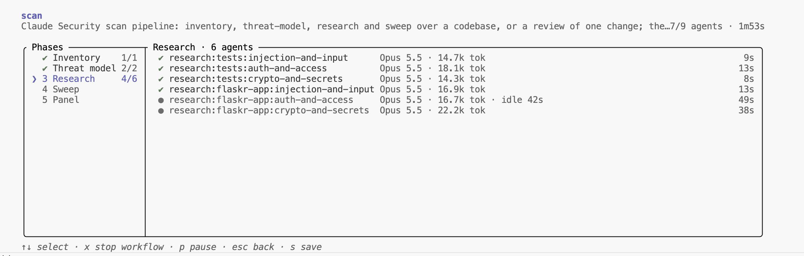
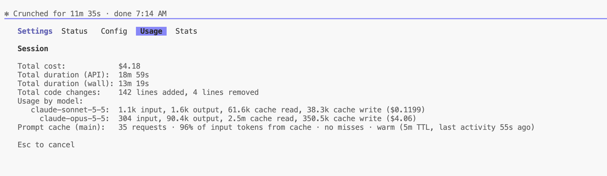
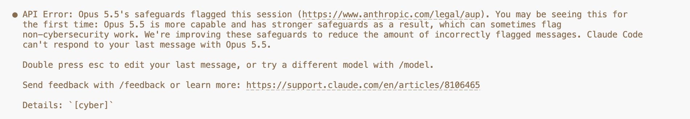

<!-- titleは自動で入る -->
AWSが開催している「[Claude/GPT などのフロンティアモデルを活用したソースコードの脆弱性対策 ハンズオン](https://aws-experience.com/apj/smb/event/460e9e2e-8636-4e5a-8c3d-4d1703b90a62)」に参加してきました。このブログでは、ワークショップで印象に残った話、Claude Security Pluginを活用するハンズオンの感想、AWS Continuumとの違いや評価観点について触れたいと思います。

AWSが最近セキュリティ系のイベントをたくさん開いてくださっています。元々月に1回くらいの頻度で、幅広いテーマでワークショップを開催されていたのですが、10月、11月の臨時セミナーがすぐに満席になったことを受けて週1回くらいのペースで開くことにしたそうです。ありがたい。
このあたりの話は [AWS セキュリティハンズオン連続開催のご案内](https://aws.amazon.com/jp/blogs/news/aws-security-handson-series/) に書かれています。
今回私が参加したのは11/11のClaude/GPT などのフロンティアモデルを活用したソースコードの脆弱性対策 ハンズオンの回です。開催形態はzoomで、200人近い参加者が集まっていました。

構成としては、以下のような流れでした。

- 最近のサイバーセキュリティ事情の紹介
- AWSでのサイバーセキュリティ事案への対応をどうしているかという話
- ハンズオンに入る前の説明

以下それぞれで、ワークショップを受けながら考えていたことを書きます。

## 最近のサイバーセキュリティ事情の紹介

体感でも最近脆弱性対応の話が多くない？と思っていましたが、実際に数字で見るとめちゃくちゃ多いですね。特にPHP2Shellは各社サービス停止をしていたので流れが変わったなとは思いました。
AIを使う攻撃者に備える3つの防御の柱として、「パッチ運用」「防御の前提」「脆弱性診断」が挙げられていました。それぞれ、パッチは日常業務として当てるもの、侵入される前提で被害を最小化すること、診断はAIで先回りして行う、という話で、脆弱性を発見して対策を打つまでのサイクルをAIを使っていかに軽量にできるかが大事なんだろうなと感じます。

## AWSでのサイバーセキュリティ事案への対応をどうしているかという話

AWSでの話題では、特にプラットフォーマーとしての話が面白かったです。脅威インテリジェンスの効果で過去12ヶ月でAWSへの攻撃の総量が55%以上減少したとか、AWSのProject Glasswingの取り組みとしてAIによるログ分析を6時間から7分に短縮した話とか、パッチを適用する部分でグローバルの全フリートに展開するまでに数時間から数日で行えるとか、規模がかなり大きな話で想像つかない部分もありつつも、特に印象に残った取り組みがいくつかありました。(私が所属している会社もプライベートクラウドを持っているので、感覚的に凄さが分かるところもいくつかあった)

## ハンズオンに入る前の説明

製品だと、AWS Continuumで、脆弱性の発見〜検証〜修正までを統合した形で提供しています。ここと比較する形で今回のハンズオンで行うフロンティアモデルとハーネスの組み合わせが紹介されました。といっても、どちらか一方を選択するものではなくて、両方組み合わせて使うように思いました。
ただフェーズによって向いているケースはありそうです。個人的な印象を書くと以下の通りです。

- AWS Continuum
  - マネージドでセキュアにしたい。特に、コードを読んでもらって脆弱性を検出するとか、AWS上にホストしたサービスを実際に検証させたい(ペネトレーションテスト)場合に向いている。
- フロンティアモデルとハーネスの組み合わせ
  - 自社である程度カスタマイズされたハーネスを持っている、マネージドよりももうちょっとカスタマイズした状態で使いたい要求がある

また、フロンティアモデルとハーネスを組み合わせる場合にどういう流れで構築すると良いかという話もありました。
モデル→ハーネス→運用の観点があり、個人的にはこの順番にも納得しました。ハーネスはモデルの賢さによって変わってくるので、どのモデルで試すか、そのモデルに適したSkillsやContextをどう設計するか、そして実際に出てきた出力をどう脆弱性対応ワークフローに載せるか、という流れだと思います。

また、Amazon Bedrockの強みとして、以下が紹介されました。

- ZOA: ゼロオペレーターアクセス
  - AWSのオペレーターが顧客データにアクセスする手段を設計の段階から排除している
  - これどうやったら実現できるのか気になりました
- ZDR: ゼロデータ保持
  - モデルの入力や出力を保持しない
  - ただし、Mythosのようなセキュリティ系のセーフガードを外した場合は安全性のためデータの一定期間保持がある
- AWSは重みをモデルプロバイダーからもらってそれをAWS内のマシンでホストしているらしく、あるモデルを使ってもデータがそのモデルのプロバイダーに流れるわけではないそうです。すごい...

この辺はやっぱり信頼のAWSという感じがしました。

続いて、いわゆるMythos級モデルを使うために必要な話(Claude CVP, OpenAI TAC)がされました。やっぱり、まずは手に届く範囲のある程度強いモデル(Opus5.5など)で試してみて、そこから物足りなくなったらCVPを検討という流れが良いようです。

次に、ハーネスの話としてClaude Security Plugin/Codex Security Pluginが紹介されました。自社で作ったAgent Skillsやハーネスと比較しても、公式Pluginの方がよりリスクを発見できた、という話があるらしいです。この理由としてはプロンプトがすごいというよりはオーケストレーションの設計が公式が上手い、という説明がありました。あんまりじっくり公式Agent Skillsの中身を見たことがないので、どのようにエージェントを役割分担させ、協調させているのかという視点で眺めてみたいと思いました。

最後に運用の話がありましたがこれは本当に体制を整えよう！という感じでした。やっぱりここは地力が試されるところだなあと思います。優先度を付けずに渡すと、未対応のfindingsが開発チームに積み上がるだけなことも多い、というのはグサッと来ました...

## ハンズオンをやってみた感想

ハンズオンの内容は、AWSが用意した環境下でClaude Security Pluginをステップごとにやっていくことで脆弱性の発見から修正までの一連の流れを体験するというものでした。
`/security-review` よりも `/claude-security` の方が重い診断だそうです。前者は一般的なセキュリティレビュー、後者は敵対的に候補を検査するイメージ。また、今回診断対象として、ローカルに構築したPythonのWebフレームワークFlaskの公式チュートリアルのブログアプリflaskrを使いました。脆弱性診断を行うSkillsをどう評価するか迷っていた(アプリを作り込むのも大変)が、こうしてサンプルアプリに走らせてみるのはありだなと感じました。

実際に動かしてみると、以下のようにPhaseが分かれてそれぞれのPhaseごとに並列でエージェントが調査や検証を行う様子が見れました。

また、ワンショットで動かして脆弱性を発見するまでで$4.18のコストがかかりました。

チュートリアル規模でこのくらいのコストがかかるということは、実運用しているアプリケーション相手だと試行錯誤の段階ですでにコストは覚悟する必要がありそうですね。

さらに、手順の途中で脆弱性が刺さるか検証するスクリプトを解説してもらおうとしたところ、セーフガードに引っかかりました。

こういうケースが増えてどうにもならない、という感じになるとCVPを検討したりするのでしょうね。

## 終わりに

ハンズオンをやってみて、「これContinuum検討のときに今回のやり方と比較したいけど、どういう観点で精度比較するといいんだろう？」と感じました。
これについて質問したところ、AWSの方から回答いただきました。自分の理解だと、まず前提としてContinuum for Penetration TestingとClaude Security PluginはDASTとSASTのような違いがある。そのうえで、以下のやり方が良さそうという感じです。

- 脆弱性の種類ごとに分類し、見つけたものと誤検知したものを評価する
- OWASP Juice Shopのような学習用のすでに脆弱性が分かっているアプリ、もしくは自社サービスなら脆弱性を改修する前の検証用ブランチを作る
- 複数回実行する
  - ワークショップでも、揺れがあるから複数回回す話が出ていました
- 指摘の分類: 検出率、誤検知、コストなどの観点から分類

また、Claude Security Pluginで見つけたものをContinuumで本当に刺さるか検証、みたいにして偽陽性を減らすというアドバイスもいただきました。

ワークショップや質疑応答のチャットのログを通して、この辺のLLMを使った脆弱性の発見とハンドリングの勘所のようなものが少し分かりました。まずは個人開発とかで素振りをしていきたいです。
次はContinuum回のワークショップを受ける予定です！楽しみ〜
